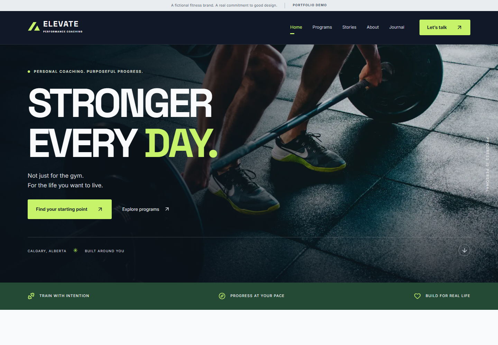
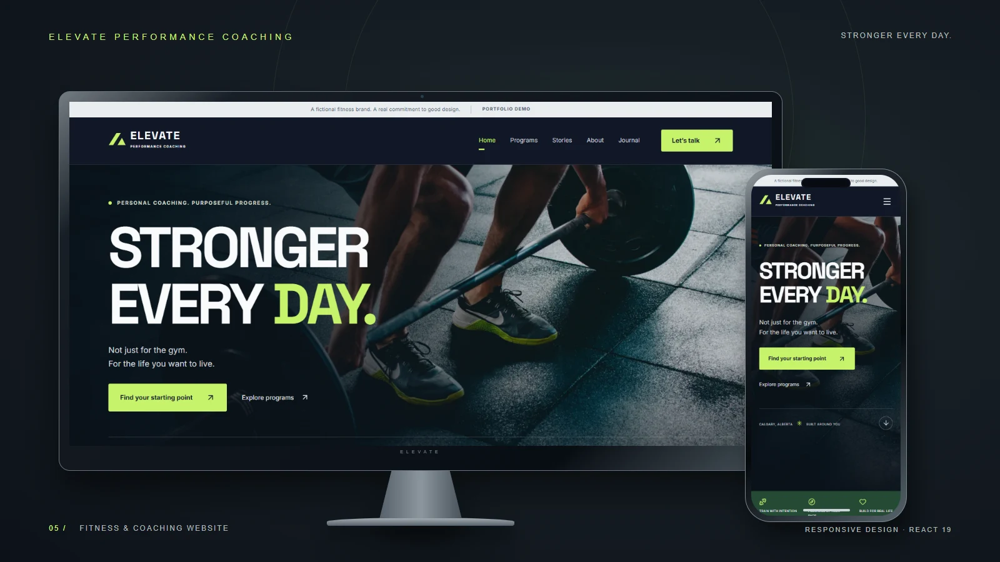

# Elevate Performance Coaching

A premium, responsive fitness coaching portfolio demonstration, imagined for Calgary, Alberta. Bold typography, cinematic photography, a charcoal/lime design system and an accessible local-only consultation experience.

**Fictional brand. Illustrative programs, prices and scenarios. No real coaching services, payments, appointments or enquiries.**

- [Production target](https://elevate-performance-coaching-one.vercel.app)
- [GitHub repository](https://github.com/awaljanhematyar/elevate-performance-coaching)
- [Portfolio target](https://hematyar-professional-portfolio.vercel.app/projects/elevate-performance-coaching)

See [delivery verification](docs/QA.md) for actual publication and test results. A target URL alone is not proof of deployment.

## Features

- Home, programs, six dynamic program details, illustrative stories, about, journal, six article details, consultation, FAQ, privacy and branded 404.
- URL-backed category/search filters, result counts and empty-state reset; journal categories and related content.
- Illustrative CAD pricing, intended audiences and sample weekly structures.
- Program consultation links preselect the program; invalid parameters safely fall back to “Help me choose”.
- Local-only form with length/email validation, required consent, focus on the first error, associated messages, duplicate protection and honest feedback.
- Keyboard FAQ, mobile menu with Escape/focus return, skip link, visible focus and reduced-motion support. Mobile sticky CTA is absent from the form page.
- Local WebP photography and WOFF2 fonts, lazy route modules, generated per-route metadata, social tags, canonicals and sitemap. Deliberately noindex for a fictional business.
- Meaningful file documentation and uppercase section comments, modular data and reusable components.

## Stack and setup

React 19 · Vite · JavaScript · Tailwind CSS v4 · React Router · Lucide React · Vitest · React Testing Library.

Use Node.js 24 and npm 11. No environment variables or credentials are required to run the app.

```sh
npm ci
npm run dev
npm run build
npm run preview
npm run lint
npm test
npm audit
```

`.npmrc` disables automatic peer installation to avoid unused optional browser integrations. The Testing Library DOM peer is explicitly installed. The lockfile defines the reproducible dependency tree.

## Customization map

| Location | Purpose |
| --- | --- |
| src/data/programs.js | Programs, CAD formatting and filters |
| src/data/articles.js | Original articles and calculated reading times |
| src/data/content.js | FAQs and fictional scenarios |
| src/components/ | Shared shell, cards, photos, buttons and FAQ |
| src/pages/ | Route content and consultation demo |
| src/utils/validation.js | Pure form validation |
| src/index.css | Tailwind integration, tokens and responsive styles |
| scripts/metadata.mjs | Per-route HTML heads, robots and sitemap |
| src/test/ | Data, interaction, validation and form privacy tests |

Edit the local data modules to change content. Update CSS variables and @theme together for design changes. Add routes in both src/App.jsx and scripts/metadata.mjs. Update deployment origin consistently in metadata and HTML when moving domains.

## Screenshots and cover

Actual browser captures are in docs/screenshots/: desktop/mobile home, desktop/mobile programs, program details and consultation.





The 1600 × 900 PNG/WebP cover uses actual homepage screenshots inside original CSS device frames. Screenshots are proportionally scaled and cropped to the frames; the UI is not invented or stretched.

## Vercel deployment

Use npm ci, npm run build and output dist. vercel.json specifies Vite, SPA fallback, security headers and immutable hashed assets. Postbuild generates unique HTML heads for twenty known routes, sitemap, robots and a 404 template. Client routing handles unknown paths; the generic SPA fallback may return HTTP 200 for the branded not-found page.

Connect GitHub main to the authenticated Vercel project or run vercel --prod. Verify direct program/article URLs, images and consultation after deployment. The fictional demo deliberately uses noindex, nofollow and Disallow: /.

## Demo boundaries and production integrations

No backend, authentication, payments, analytics, cookies or personal-data persistence. Form values exist temporarily in React memory, are discarded after completion and are never submitted. Use sample values; do not enter health history or sensitive information. Hosting providers may process standard request information.

Articles are general education. Scenarios are explicitly fictional, with no testimonials, credentials, medical claims or before-and-after evidence. Real production use would need real business content, qualified review, privacy/legal review, secure enquiry transport/storage and booking integration.

## Assets and QA helpers

See [image/font licensing](docs/IMAGE-CREDITS.md). Open-font licenses are in public/fonts/. Original source has no separately granted redistribution license.

scripts/browser-qa.cjs checks production-preview routes, responsive layout, interactions and axe rules, then saves real screenshots. scripts/portfolio-cover.cjs renders the device composition. These helpers use pre-existing local Playwright, Sharp and axe tools through explicit absolute paths; adapt those paths on another machine. They are not application dependencies. Asset download scripts require network access and never run during build/deployment.

Automated accessibility checks are not a WCAG certification. Screen-reader and physical-device testing remain separate. Exact results and limitations are in [QA.md](docs/QA.md) and [memory.md](memory.md).
